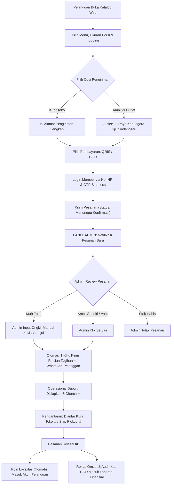
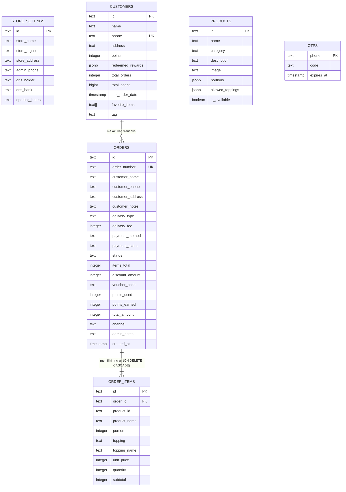

# PRODUCT REQUIREMENTS DOCUMENT (PRD)
## Sistem Manajemen Pesanan, CRM Retensi & Self-Ordering UMKM "Dimsummentai Mamifayy"

---

## 📑 Informasi Dokumen

| Properti | Keterangan |
| :--- | :--- |
| **Judul Proyek** | Dimsummentai Mamifayy Web Platform |
| **Versi Dokumen** | 1.0.0 (Production Ready) |
| **Tanggal Pembaruan** | November 2026 |
| **Status Dokumen** | Disetujui (Approved) |
| **Target Implementasi** | Next.js 14 App Router, TypeScript, Tailwind CSS, Supabase PostgreSQL, Vercel |
| **Repositori GitHub** | [https://github.com/arulfahrul1555-star/dimsummentai-mamifayy](https://github.com/arulfahrul1555-star/dimsummentai-mamifayy) |

---

## 1. Pendahuluan & Latar Belakang (Introduction & Problem Statement)

### 1.1 Latar Belakang
**Dimsummentai Mamifayy** adalah unit usaha kuliner (UMKM) yang berfokus pada olahan aneka dimsum kukus *homemade* premium dengan saus mentai gurih dan keju *torched* lumer. Penjualan dilakukan secara *ready stock* setiap hari melalui gerai fisik serta pemesanan online melalui WhatsApp dan Instagram.

### 1.2 Masalah yang Dihadapi (Problem Statement)
Sebelum adanya sistem terintegrasi ini, proses operasional mengalami inefisiensi nyata:
1. **Beban Chat Manual**: Admin harus menjawab pertanyaan pelanggan yang berulang mengenai daftar menu, ukuran porsi (isi 4, 6, 8, 10, 16 pcs), pilihan topping, dan ketersediaan stok.
2. **Penghitungan Ongkir Kurir yang Fleksibel**: UMKM memiliki kurir toko sendiri, di mana tarif ongkir harus ditentukan adil berdasarkan jarak riil (bukan tarif kaku aplikasi ojek online yang mengenakan potongan komisi 20–30%).
3. **Rekapitulasi Finansial Tercecer**: Pembayaran terbagi antara QRIS/Transfer Bank dan uang tunai COD (*Cash on Delivery*). Sering terjadi selisih antara uang kas yang dibawa kurir toko saat kembali ke outlet dengan catatan pesanan.
4. **Data Pelanggan Mengendap**: Riwayat nomor WhatsApp dan preferensi pelanggan tenggelam di chat, sehingga program promosi retensi (loyalitas) tidak dapat dijalankan secara terstruktur.

### 1.3 Tujuan Produk (Product Goals)
- Membangun **Katalog Pemesanan Mandiri (*Self-Ordering Web*)** yang dapat diakses langsung oleh pelanggan melalui tautan di bio Instagram dan WhatsApp.
- Membangun **Pusat Kendali Admin (*Admin Hub & POS*)** dengan fitur persetujuan pesanan (*order approval*), penetapan ongkir kurir manual, dan integrasi WhatsApp 1-klik.
- Membangun **Sistem CRM & Loyalitas Poin**: Pelanggan mengumpulkan poin setiap transaksi untuk ditukarkan dengan voucher diskon atau porsi gratis.
- Menerapkan **Arsitektur Hybrid Database Modern**: Menggunakan Supabase PostgreSQL di cloud dengan ketahanan serverless Vercel, serta kemampuan fallback mulus ke database lokal saat offline.

---

## 2. Pengguna Sasaran (User Personas)

### 2.1 Persona 1: Pelanggan (Customer)
- **Karakteristik**: Pengguna smartphone, ingin memesan dimsum hangat tanpa repot antre chat atau men-download aplikasi berat di App Store/Play Store.
- **Kebutuhan**: Melihat foto menu asli, memilih topping mentai/keju, memilih pengiriman (Kurir Toko atau Ambil di Outlet), memantau status pesanan secara *real-time*, dan mengumpulkan poin hadiah.

### 2.2 Persona 2: Admin Toko & Kasir (Store Admin)
- **Karakteristik**: Pemilik toko atau staf kasir yang mengelola dapur, antrean pesanan, dan penugasan kurir.
- **Kebutuhan**: Notifikasi pesanan baru masuk, form cepat untuk memasukkan nominal ongkir kurir toko, tombol 1-klik untuk mengirim rincian tagihan + rekening QRIS ke WhatsApp pelanggan, kasir kilat (POS) untuk pembeli yang datang langsung ke gerai fisik, dan rekap setoran kas kurir COD harian.

### 2.3 Persona 3: Dosen / Evaluator Akademik
- **Karakteristik**: Penilai proyek software engineering / sistem informasi.
- **Kebutuhan**: Validasi implementasi *full-stack* modern: Next.js 14 App Router, TypeScript type safety, PostgreSQL Relational Schema dengan Foreign Keys & Cascade Delete, Row Level Security (RLS), CI/CD GitHub ke Vercel, dan dokumentasi PRD yang komprehensif.

---

## 3. Alur Sistem & Arsitektur (User Flow & Architecture)

### 3.1 Diagram Alur Transaksi (Transaction Flowchart)

---

## 4. Kebutuhan Fungsional (Functional Requirements)

### 4.1 Modul 1: Katalog Pemesanan Pelanggan (Customer Facing Web)
| ID | Kebutuhan Fungsional | Kriteria Penerimaan (*Acceptance Criteria*) |
| :--- | :--- | :--- |
| **FR-01.1** | Navigasi Kategori Menu | Menampilkan filter kategori: `Semua`, `Signature`, `Klasik`, `Favorit`, `Gorengan`. |
| **FR-01.2** | Pilihan Porsi Dinamis | Pelanggan dapat memilih porsi box (misal Dimsum Mentai: isi 6, 8, 10, 16 pcs; Dimsum Ayam: isi 4, 6, 8 pcs) dengan kalkulasi harga otomatis. |
| **FR-01.3** | Aturan Topping Eksklusif | Pilihan topping (*Original*, *Keju Mozzarella +Rp 5rb*, *Keju Melting Torched +Rp 6rb*) **hanya muncul pada menu Dimsum Mentai Spesial**. Menu non-mentai otomatis tanpa topping. |
| **FR-01.4** | Pilihan Metode Pengiriman | 1. **Kurir Toko**: Wajib mengisi alamat lengkap pengiriman. Ongkir awal bernilai Rp 0 (diisi manual oleh admin saat konfirmasi). 2. **Ambil di Outlet (Pickup)**: Otomatis menampilkan alamat fisik: `📍 Jalan Raya Kadungora Kp. Sindangsari Rt.03 Rw.07`. Ongkir Rp 0. |
| **FR-01.5** | Pilihan Metode Pembayaran | Pelanggan dapat memilih `QRIS / Transfer Bank` atau `Bayar Tunai di Tempat (COD)`. |
| **FR-01.6** | Live Order Tracking | Setelah pesanan dikirim, pelanggan dialihkan ke halaman `/order/[id]` yang melakukan polling otomatis status pesanan dari `Menunggu Konfirmasi` hingga `Selesai`. |
| **FR-01.7** | Menu Spesial Dimsum Tart & Mix Platter | Halaman dedicated `/dimsum-tart` dan filter kategori `Dimsum Tart` menampilkan 7 varian paket kue tart & mix platter: Paket Tart 1 s/d 5 (Rp 40rb - Rp 80rb) dan Mix Platter Reguler & Large (Rp 30rb - Rp 55rb) dengan integrasi pemesanan WhatsApp langsung. |

### 4.2 Modul 2: Autentikasi Member & Loyalitas Poin
| ID | Kebutuhan Fungsional | Kriteria Penerimaan (*Acceptance Criteria*) |
| :--- | :--- | :--- |
| **FR-02.1** | Login Tanpa Password (OTP) | Pelanggan cukup menginput nomor HP/WhatsApp. Sistem mengirimkan kode OTP 4-digit. |
| **FR-02.2** | Stateless Serverless OTP | Kode OTP dihitung menggunakan algoritma deterministik *time-window* 5 menit, sehingga valid di seluruh container lambda Vercel tanpa kendala *lost in-memory session*. Tersedia kode master demo: `1234` dan `8888`. |
| **FR-02.3** | Bonus Poin Registrasi | Akun baru yang mendaftar otomatis mendapatkan bonus selamat datang **100 Poin Loyalitas**. |
| **FR-02.4** | Perolehan Poin Transaksi | Pesanan dengan nilai belanja $\ge \text{Rp } 50.000$ mendapat 10 poin; di bawahnya mendapat 5 poin. |
| **FR-02.5** | Penukaran Voucher Hadiah | Pelanggan dapat menukarkan poin: `100 Poin` (Diskon 10%), `200 Poin` (Diskon 20%), `250 Poin` (Gratis Dimsum Original Isi 5). |

### 4.3 Modul 3: Panel Admin & Kasir Kilat (Admin Hub & POS)
| ID | Kebutuhan Fungsional | Kriteria Penerimaan (*Acceptance Criteria*) |
| :--- | :--- | :--- |
| **FR-03.1** | Autentikasi Admin | Login admin dengan kredensial terverifikasi: `adminmamifay@gmail.com` / `admin123`. |
| **FR-03.2** | Persetujuan Pesanan & Input Ongkir | Admin dapat menginput nominal ongkir kurir toko secara bebas sebelum menyetujui pesanan. Total tagihan terhitung otomatis: $\text{Total} = \text{Subtotal} - \text{Diskon} + \text{Ongkir}$. |
| **FR-03.3** | Otomasi WhatsApp 1-Klik | Tombol WhatsApp membuat URL `wa.me/` dengan template pesan otomatis lengkap: nomor order, rincian item, ongkir, rekening QRIS, dan ucapan terima kasih. |
| **FR-03.4** | Papan Operasional Dapur | Pembaruan status pesanan: `menunggu_konfirmasi` ➡️ `disetujui` ➡️ `diproses` ➡️ `dikirim` / `siap_pickup` ➡️ `selesai` / `dibatalkan`. |
| **FR-03.5** | Kasir Kilat (POS) | Memungkinkan admin menginput pesanan manual bagi pelanggan yang datang langsung (*walk-in*) ke outlet fisik tanpa merusak kalkulasi keranjang jika menu tidak memiliki topping. |
| **FR-03.6** | Manajemen Pengaturan Toko | Admin dapat mengedit nama toko, alamat outlet, jam buka, dan nomor WhatsApp admin melalui tab pengaturan (`/api/settings`). |

### 4.4 Modul 4: Database Pelanggan & Laporan Keuangan (CRM & Finance)
| ID | Kebutuhan Fungsional | Kriteria Penerimaan (*Acceptance Criteria*) |
| :--- | :--- | :--- |
| **FR-04.1** | Sinkronisasi Anti-Duplikasi CRM | Pembaruan status pesanan yang berulang tidak menduplikasi nilai `total_orders`, `total_spent`, maupun perolehan poin pelanggan. Pembatalan pesanan secara akurat merestorasi statistik. |
| **FR-04.2** | Segmentasi Pelanggan Otomatis | Menandai pelanggan dengan label: `Pelanggan Baru`, `Pelanggan Setia / VIP` (order > 3x atau belanja $\ge \text{Rp } 150.000$), dan `Lama Tidak Order` (> 14 hari). |
| **FR-04.3** | Audit Kas Kurir (COD) vs QRIS | Memisahkan laporan penerimaan uang tunai yang harus disetor kurir toko vs uang yang masuk melalui QRIS BCA. |

---

## 5. Kebutuhan Non-Fungsional (Non-Functional Requirements)

| Kategori | Parameter & Spesifikasi |
| :--- | :--- |
| **Performa (Performance)** | Halaman awal terkompilasi optimal dengan Next.js 14 Server Components. Skor *Largest Contentful Paint (LCP)* < 2.0 detik pada jaringan 4G mobile. |
| **Keandalan (Reliability)** | **Smart Hybrid Database Layer**: Jika environment variables Supabase belum aktif atau database cloud sedang *sleep*, sistem secara otomatis beralih ke fallback database lokal (`data/db.json`) agar aplikasi tidak pernah mengalami error 500. |
| **Keamanan (Security)** | - **Row Level Security (RLS)** aktif di seluruh tabel PostgreSQL Supabase. - API routes memvalidasi input payload dan menggunakan `SUPABASE_SERVICE_ROLE_KEY` hanya di sisi server backend. - File `.env.local` dikecualikan dari Git versioning via `.gitignore`. |
| **Kompatibilitas Serverless** | Seluruh API route handler di-set dengan `export const dynamic = 'force-dynamic'` guna mencegah *stale cache* pada runtime serverless Vercel. Unggahan gambar mendukung data URL base64 untuk mengatasi *read-only filesystem* di cloud. |
| **Desain & Branding** | Mengadopsi palet warna resmi Mamifayy: **Royal Blue (`#004AAD`)**, putih bersih, dan aksen kuning keemasan yang higienis, ramah seluler (*mobile-first*), dan modern. |

---

## 6. Arsitektur Data & Skema Database (Database Schema)

Sistem menggunakan database relasional **PostgreSQL (Supabase)** dengan skema sebagai berikut:

---

## 7. Rincian Antarmuka Pemrograman Aplikasi (API Endpoints)

| Endpoint | Metode | Deskripsi | Akses |
| :--- | :--- | :--- | :--- |
| `/api/menu` | `GET` | Mengambil daftar produk aktif dan pengaturan toko | Publik |
| `/api/menu` | `PUT` | Memperbarui nama, deskripsi, atau foto produk | Admin |
| `/api/orders` | `GET` | Mengambil riwayat pesanan (filter status & metode bayar) | Admin |
| `/api/orders` | `POST` | Membuat pesanan baru dari website atau POS kasir | Publik / Admin |
| `/api/orders/[id]` | `GET` | Mengambil rincian status pesanan berdasarkan ID | Publik / Pelanggan |
| `/api/orders/[id]` | `PATCH` | Memperbarui status pesanan, nominal ongkir, atau pembayaran | Admin |
| `/api/orders/[id]` | `DELETE` | Menghapus pesanan beserta relasi itemnya | Admin |
| `/api/customers` | `GET` | Mengambil daftar seluruh pelanggan CRM dan loyalitas | Admin |
| `/api/auth/otp/send` | `POST` | Mengirimkan kode OTP login ke nomor HP pemesan | Publik |
| `/api/auth/otp/verify` | `POST` | Memvalidasi kode OTP dan mengembalikan data profil member | Publik |
| `/api/customers/redeem`| `POST` | Menukarkan poin pelanggan dengan voucher hadiah | Member |
| `/api/settings` | `GET`, `PUT` | Membaca dan memperbarui identitas outlet & QRIS toko | Admin |
| `/api/analytics` | `GET` | Rekapitulasi omzet, porsi terlaris, dan audit kas kurir COD | Admin |

---

## 8. Panduan Deployment & Verifikasi (Deployment & CI/CD)

### 8.1 Alur Deployment GitHub ke Vercel
1. Seluruh perubahan kode di-commit pada branch `main` repositori lokal.
2. Perintah `git push -u origin main` menyinkronkan kode ke GitHub:
   `https://github.com/arulfahrul1555-star/dimsummentai-mamifayy`
3. Vercel secara otomatis mendeteksi *push trigger* melalui webhook CI/CD, mengeksekusi `next build`, dan mempublikasikan versi terbaru ke URL produksi.

### 8.2 Konfigurasi Environment Variables di Vercel
- `NEXT_PUBLIC_SUPABASE_URL`: URL project Supabase (`https://xxxx.supabase.co`).
- `NEXT_PUBLIC_SUPABASE_ANON_KEY`: Kunci publik client-side Supabase.
- `SUPABASE_SERVICE_ROLE_KEY`: Kunci rahasia server-side untuk bypass RLS pada route handler backend.

---

## 9. Penutup & Tanda Tangan Persetujuan

Dokumen PRD ini disusun sebagai acuan spesifikasi fungsional dan teknis aplikasi **Dimsummentai Mamifayy** dalam memenuhi kriteria evaluasi tugas akademik rekayasa perangkat lunak dan implementasi operasional UMKM riil.

| Disusun Oleh | Diperiksa Oleh | Status |
| :---: | :---: | :---: |
| **Tim Pengembang Dimsummentai Mamifayy** | **Dosen Pembimbing / Evaluator** | **Production Ready (Vercel & Supabase)** |
